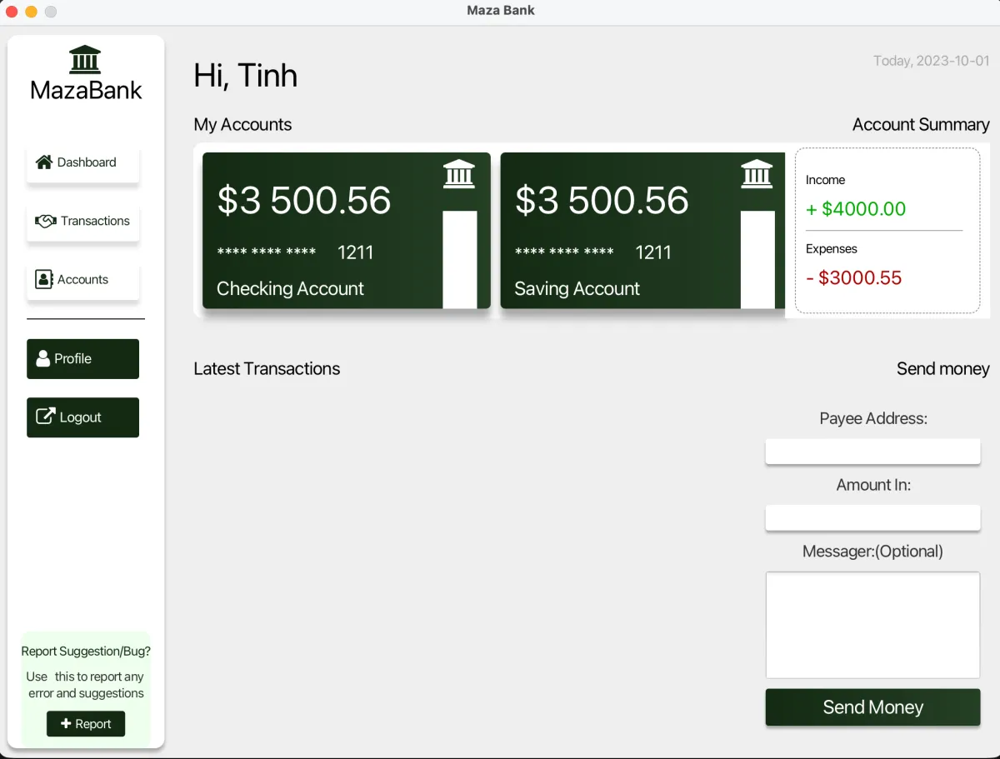
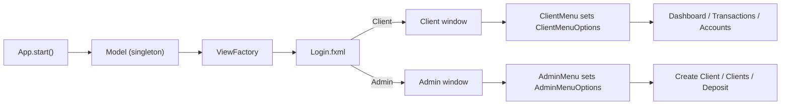

# MazaBank

A JavaFX desktop banking app prototype with separate Client and Admin windows. Learning project from October–December 2023: the screens, navigation and data model are in place, while authentication, money movement and database access are not yet implemented in the committed code.

 



*Client dashboard. Balances, names and dates are static placeholder values from `Dashboard.fxml`.*

## Overview

The goal was to practise building a multi-window JavaFX application with FXML layouts, controllers, custom styling and a shared application model. A login screen lets the user pick an account type, then opens either the client workspace (dashboard, transactions, accounts) or the admin workspace (create client, clients list, deposit). Each workspace uses a sidebar menu that swaps the centre view.

## What is implemented

- **Login window** with a Client/Admin selector that opens the matching window (`Controllers/LoginController.java`). Payee address and password fields are present but not checked yet.
- **Client workspace**: sidebar menu (Dashboard, Transactions, Accounts) and three views — account cards with income/expense summary and a send-money form, a transactions list, and a checking ↔ savings transfer form (`Fxml/Client/*.fxml`).
- **Admin workspace**: sidebar menu (Create Client, Clients, Deposit) and three views — a create-client form with optional checking and savings accounts, a clients list, and a deposit search form (`Fxml/Admin/*.fxml`).
- **Domain model** using JavaFX properties: abstract `Account` with `CheckingAccount` (transaction limit) and `SavingAccount` (withdrawal limit), plus `Client` and `Transaction` (`Models/`).
- **Shared state**: `Model` is a lazily created singleton that exposes the `ViewFactory`; the factory caches each centre view after its first load (`Models/Model.java`, `Views/ViewFactory.java`).
- **Menu navigation through observable properties**: menu controllers set an enum value (`ClientMenuOptions`, `AdminMenuOptions`) and the window controller listens and swaps the `BorderPane` centre.
- **Custom list cells**: `ClientCellFactory` and `TransactionCellFactory` load an FXML layout per row (`Views/`).
- **Styling**: one stylesheet per view in `src/main/resources/Styles/`, with FontAwesomeFX icons.
- **Database file**: `mazebank.db` (SQLite) with `Admins`, `Clients`, `CheckingAccounts`, `SavingsAccounts` and `Transactions` tables; `sqlite-jdbc` is declared in `pom.xml`.

## Tech stack

| Layer | Technology |
| --- | --- |
| Language | Java 19 (compiler source/target in `pom.xml`) |
| UI | JavaFX 20.0.1 (`javafx-controls`, `javafx-fxml`), FXML, CSS |
| Icons | FontAwesomeFX `fontawesomefx-fontawesome` 4.7.0-9.1.2 |
| Database | SQLite (`org.xerial:sqlite-jdbc` 3.42.0.0) |
| Build | Maven with wrapper (Maven 3.8.5), `javafx-maven-plugin` 0.0.8 |
| Tests | JUnit 5.9.2 declared; no tests yet |

## Architecture



Views are FXML files with one controller each. `ViewFactory` creates stages, loads views and holds the selected-menu properties; window controllers (`ClientController`, `AdminController`) observe those properties and replace the centre pane.

## Project structure

```text
src/main/java/com/example/mazabank/
├── App.java                 # JavaFX entry point, opens the login window
├── Controllers/             # LoginController, Admin/* and Client/* controllers
├── Models/                  # Model singleton, Account hierarchy, Client, Transaction
└── Views/                   # ViewFactory, menu option enums, list cell factories
src/main/resources/
├── Fxml/                    # Login, Admin/* and Client/* layouts
└── Styles/                  # One stylesheet per view
mazebank.db                  # SQLite database file
```

## Getting started

Prerequisites: JDK 19 or newer. Maven is provided through the wrapper.

```bash
git clone https://github.com/tinhne/MazaBank.git
cd MazaBank
./mvnw clean javafx:run      # Windows: mvnw.cmd clean javafx:run
```

The build currently fails: `Model.java` references a `DatabaseDriver` class that is not in the repository. See below.

## Known limitations

- `DatabaseDriver` (the SQLite access class) is referenced but was never committed, so the project does not compile at the latest commit.
- The window icon `/Images/bank-building.png` is referenced in `ViewFactory.createStage` but missing from `src/main/resources`.
- Login does not check credentials; it only opens the selected window.
- Transfers, deposits, client creation and transaction history have forms but no logic yet; most controllers have empty `initialize` methods.
- The list cell factories are not attached to any `ListView` yet, and `TransactionCellFactory` loads `/Fxml/Client/TransactionCell` without the `.fxml` extension.
- Logout, Profile and Report buttons are not wired.
- `mazebank.db` contains sample rows with plaintext passwords; a real app would hash them.

## Author

**Lê Văn Trung Tính** — Software Engineer | AI Product Builder

- Website: [trungtinh.site](https://trungtinh.site)
- GitHub: [@tinhne](https://github.com/tinhne)
